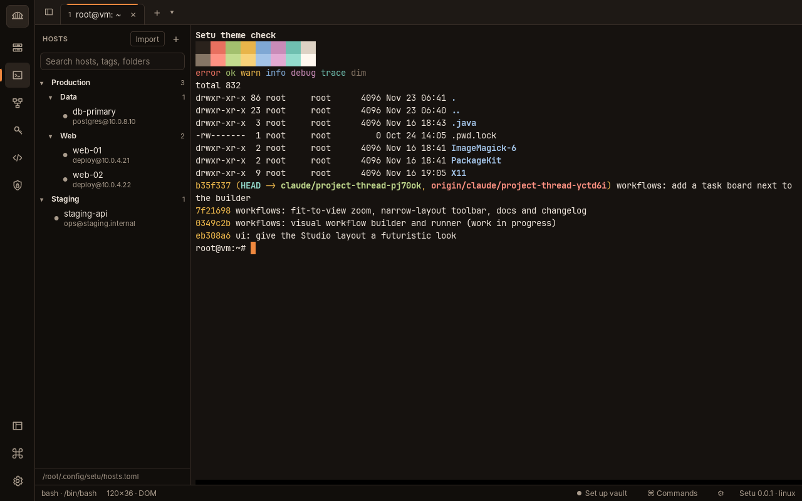
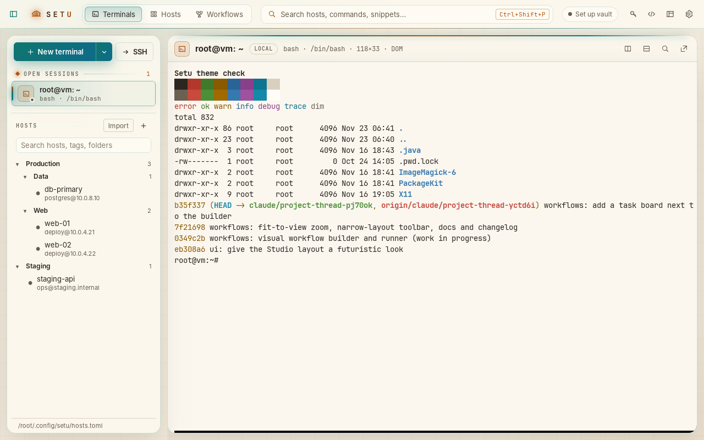
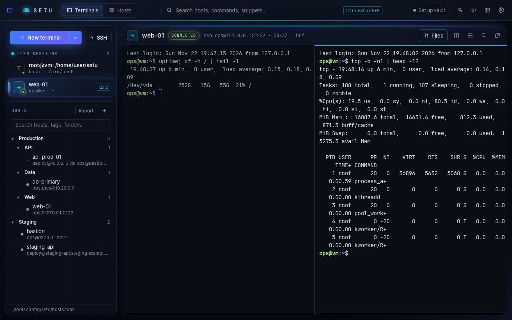
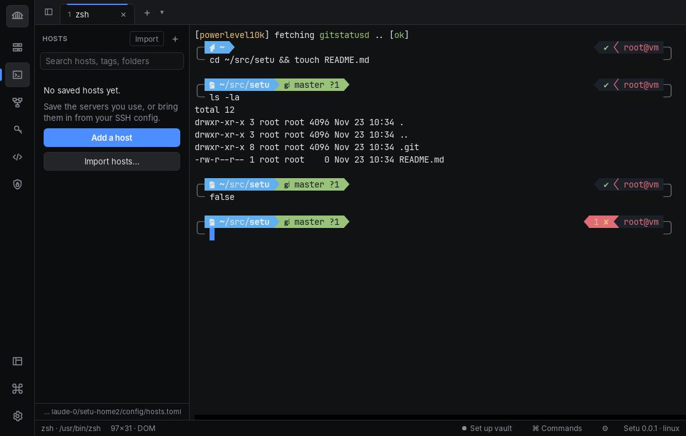
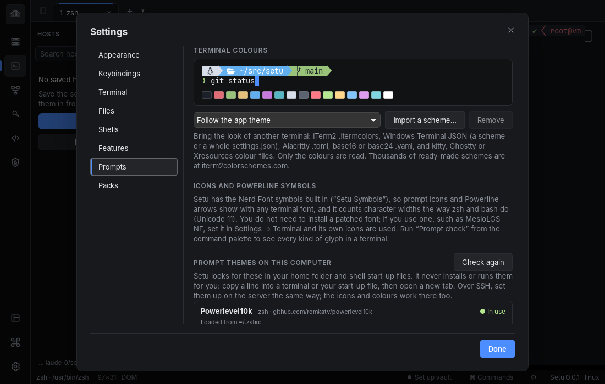

# Appearance: themes, layouts, fonts and prompts

How Setu looks is up to you: a colour theme for the whole app, one of two window layouts, the terminal font and renderer, and support for fancy shell prompts such as Powerlevel10k. Every choice is saved in `settings.json` (see [Settings](settings.md)) and applies straight away, without restarting your sessions.

## Themes

Settings → **Appearance** has seven themes. Each one colours the whole app and the terminal, in both the Classic and Studio layouts:

| Theme | Look |
|---|---|
| **Dark** (the default) | Graphite with a blue accent, easy on the eyes |
| **Light** | Clean white surfaces, for bright rooms |
| **High contrast** | Pure black and white with strong focus outlines |
| **Ocean** | Deep blue-green with a teal accent, calm for long night shifts |
| **Paper** | Warm off-white with an amber accent, soft on the eyes by day |
| **Ember** | Warm charcoal with an amber glow, for late nights |
| **Sandstone** | Soft paper tones with a teal accent, gentle in daylight |

The terminal font size is set there too. Themes are also in the command palette (type `Theme`). To give only the terminal another set of colours, import a colour scheme (see [Settings → Prompts](#settings--prompts) below).

## Layouts: Classic and Studio

Settings → Appearance → **Layout** switches how the window is arranged. Both show the same tabs, hosts and dialogs, and switching keeps every shell and connection running.

- **Classic** (the default): the icon rail on the left, tabs across the top, the hosts sidebar beside the terminal and a status bar at the bottom.
- **Studio**: a futuristic look (glass panels over a deep background with a faint grid, neon edges and glows, HUD-style labels; High contrast stays plain black and white) with a title bar with a search box for everything (it opens the command palette), a **Terminals / Hosts** switch, and the vault, keys, snippets and settings on the right. The navigator on the left lists open sessions with their state (a green dot for a connected SSH session, amber while it waits to reconnect, red once it has exited), with the saved hosts tree under them. Above the terminal, a header shows the session's name, state, address and size, with buttons for Files, Split right, Split down, Find and Move to a new window. The button left of the Setu name hides or shows the navigator.

Switch from the palette too (`Layout: Classic layout`, `Layout: Studio layout`), or with the layout button in the Classic rail and in the Studio title bar. The choice is saved as `"layout"` in `settings.json`.

## Rendering, fonts and ligatures

Settings → Terminal → Rendering chooses how terminals are drawn:

- **Automatic** (the default) draws with the GPU (WebGL) on macOS and Windows. On Linux it uses the compatible DOM renderer, because under some WebKitGTK setups the GPU canvas shows new output one frame late.
- **GPU (WebGL)** always draws with the GPU. If the GPU context is lost (a driver reset, waking from sleep) the terminal falls back to the DOM renderer.
- **Compatible (DOM)** never uses the GPU.

The status bar shows which renderer the current terminal uses, after its size (`97×31 · GPU`).

**Font** sets the terminal font; empty means the first installed of JetBrains Mono, Cascadia Code, Fira Code, SF Mono, Menlo or Consolas. Nerd Font icons work with any of them (see [Prompt themes](#prompt-themes-powerlevel10k-oh-my-zsh-starship-oh-my-posh) below). **Font ligatures** (on by default) joins sequences such as `->`, `=>`, `!=` and `>=` into one symbol when the font has ligatures, as JetBrains Mono, Cascadia Code and Fira Code do. Changes apply to open terminals straight away.

## Prompt themes: Powerlevel10k, Oh My Zsh, Starship, Oh My Posh

Prompts from these tools work in Setu without a patched font:

- **Icons and Powerline arrows are built in.** Setu ships the Nerd Font symbols (Symbols Nerd Font Mono, from Nerd Fonts 3.4) and uses them only for icon characters your terminal font does not have. If you set a Nerd Font yourself (Settings → Terminal → Font, for example `MesloLGS NF`), its own icons are used. With the GPU renderer, Powerline arrows and box lines are drawn to fit each cell exactly.
- **Widths match your shell.** Terminals count wide characters (CJK, emoji, some symbols) with Unicode 11 widths, as zsh and bash do, so right-hand prompts, icons and emoji stay in their columns. This applies to tabs opened after the setting changes.
- **True colour.** Local shells get `TERM=xterm-256color`, `COLORTERM=truecolor` and `TERM_PROGRAM=Setu`. SSH sessions ask the server to set `COLORTERM=truecolor` too; most servers accept only `LANG` and `LC_*` (`AcceptEnv` in `sshd_config`), so add `export COLORTERM=truecolor` to the server's start-up file if a prompt there looks washed out.

Run **Prompt check** from the command palette (Ctrl+Shift+P) to see a Powerline prompt, Nerd Font icons, a true-colour ramp, the 16 ANSI colours and a width ruler drawn in the current terminal. It is only written to the screen; the shell never sees it.

### Settings → Prompts

- **Terminal colours**: keep following the app theme, or import a colour scheme from another terminal: iTerm2 `.itermcolors`, Windows Terminal JSON (one scheme, a list, or a whole `settings.json` with all its `schemes`), Alacritty `.toml`, base16 or base24 `.yaml`, and kitty, Ghostty or Xresources colour files. Thousands are at iterm2colorschemes.com. Only the colours are read (16 ANSI colours, foreground, background, cursor and selection); imported schemes are saved in `settings.json` (at most 50) and also listed in the palette under `Terminal colours`. The app's own theme stays as it is.
- **Prompt themes on this computer**: whether Powerlevel10k, Oh My Zsh, Starship and Oh My Posh are installed and turned on in your shell start-up files, with the lines to copy for the ones that are not. Setu only looks; it never installs or runs them. To use them over SSH, set them up on the server the same way.

All of this sits behind the `promptThemes` flag in Settings → Features (see [Settings](settings.md#features)).

