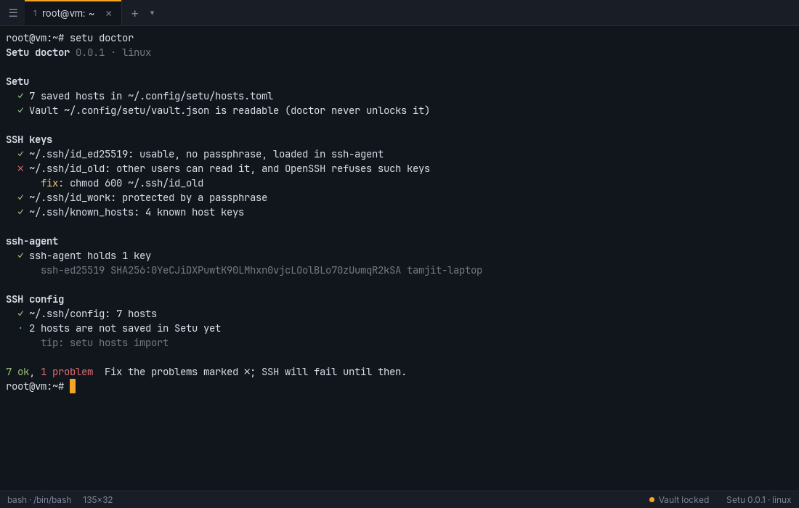

# The `setu` command line

`setu` works on the same files as the desktop app: your saved hosts, the vault and `~/.ssh`. Use it to check a machine's SSH setup, or to list and import hosts from a terminal or a script.

The nightly builds include the CLI for each platform (`setu-cli-…` archives on the [Releases page](https://github.com/SanowerTamjit/setu/releases/tag/nightly)); unpack it and put `setu` on your `PATH`. Or build it from source:

```sh
cargo install --path crates/setu-cli    # from a source checkout
setu --help
```

## `setu doctor`

Checks the things that make SSH fail in confusing ways, and says how to fix each one. It only reads: it never changes a file, unlocks the vault or asks for a passphrase.

| Section | What it checks |
|---------|----------------|
| Setu | Saved hosts file parses; every host is valid; key files named by hosts exist; the vault file is a vault this version can open; neither file is open to other users |
| SSH keys | Every private key in `~/.ssh` (and every key named by a host or `IdentityFile`): not readable by other users (OpenSSH refuses those), loads, needs a passphrase or not, and whether ssh-agent already holds it; `~/.ssh` is not writable by others; `known_hosts` is readable |
| ssh-agent | An agent is reachable (`SSH_AUTH_SOCK` on macOS and Linux; the OpenSSH agent service or Pageant on Windows) and which keys it holds. No agent is fine, unless you have passphrase keys it would save you typing for |
| SSH config | `~/.ssh/config` is not writable by others (OpenSSH's "Bad owner or permissions"), reads cleanly, every `IdentityFile` exists, and how many hosts are not imported into Setu yet |



Each line is marked ✓ (fine), · (for your information), ! (worth a look) or ✗ (SSH will fail), with a `fix:` line where there is something to do.

```
$ setu doctor
Setu doctor 0.0.1 · linux

SSH keys
  ✓ ~/.ssh/id_ed25519: usable, no passphrase, loaded in ssh-agent
  ✗ ~/.ssh/id_old: other users can read it, and OpenSSH refuses such keys
      fix: chmod 600 ~/.ssh/id_old
...
5 ok, 1 problem  Fix the problems marked ✗; SSH will fail until then.
```

- `--json` prints the findings and totals as JSON, for scripts and bug reports.
- Exit code: `0` when nothing is marked ✗, `1` when something is, `2` when doctor itself could not run.
- Colour is used only on a terminal; set `NO_COLOR=1` to turn it off.

Permission checks apply to macOS and Linux; Windows uses ACLs, which doctor does not inspect yet.

## `setu hosts`

```sh
setu hosts                 # list saved hosts, by folder
setu hosts ls prod         # only hosts whose name, address, user, folder or tag contains "prod"
setu hosts list --json     # the hosts as JSON
```

## `setu hosts import`

Reads `~/.ssh/config` (with its `Include`s) and shows each host as **new**, **changed**, **same** or **skipped**, with what could not be carried over. Nothing is saved until you add `--write`:

```sh
setu hosts import                            # preview
setu hosts import --write                    # save new and changed hosts
setu hosts import --write --folder Imported  # put new hosts in another folder
```

It follows the same rules as **Import** in the app (see [hosts.md](hosts.md)): hosts you already saved keep their folder, tags and notes and only take the new connection settings.

## `setu paths`

Prints where Setu keeps its files on this machine (respecting `SETU_HOME`).

## Not yet

Connecting from the command line (`setu ssh <host>`) and copying files (`setu cp`) are planned; for now, use `ssh` with the same `~/.ssh/config`, or the desktop app.
