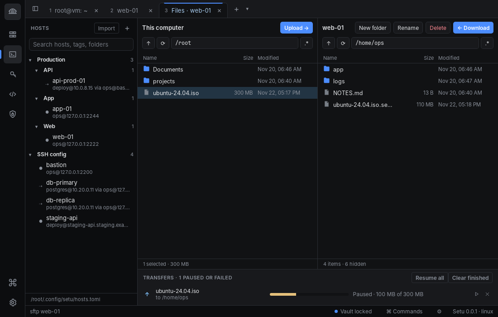
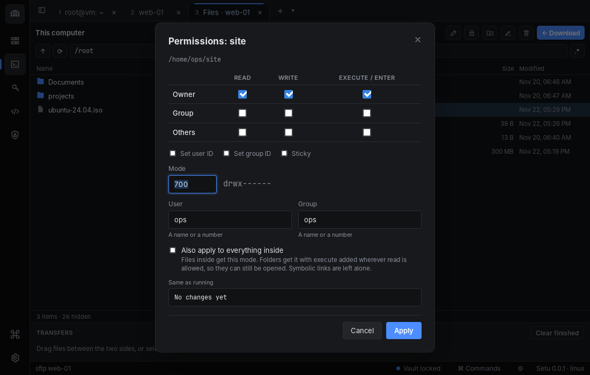

# Files (SFTP)

A Files tab shows your computer on the left and an SSH host on the right, and copies files between them over SFTP. It uses the connection of an open SSH tab, so there is no second login.

## Opening a Files tab

- From an SSH tab: click **Files** in the status bar, or press **Ctrl+Shift+E**.
- From the hosts sidebar: click **⇅** on a host. Setu connects first if needed, then opens the Files tab.

The Files tab keeps the connection open even if you close its SSH tab.

## Browsing

- Double-click a folder (or press **Enter**) to open it; **Backspace** or the **↑** button goes up. Type a path in the path box and press **Enter** to jump there.
- Click to select, **Shift**-click for a range, **Ctrl**-click to add or remove one item, **Ctrl+A** for all.
- **.\*** shows or hides hidden files (names starting with a dot).
- On the remote side: **New folder**, **Rename** (**F2**) and **Delete** (**Delete** key). Deleting asks first, and deletes folders with everything inside.

## Copying

- Select items and click **Upload →** or **← Download**, or drag them from one side to the other. Items go into the folder open on the other side.
- If something with the same name is already there, Setu asks before replacing it.
- Folders are copied with everything inside. Symbolic links to folders are skipped, so a link loop cannot copy forever.
- Copies run one after another in the **Transfers** list, with bytes done, speed and file count.
- Each file is written as `name.setu-part` and renamed to its real name only when it is complete, so you are never left with a truncated file that looks complete.

### Pause, resume and retry

- **Pause** (or **Pause all**) stops a copy and keeps its `.setu-part` file. **Resume** (or **Resume all**) continues it from the byte where it stopped; files that were already finished are skipped.
- A copy that **fails** (for example the connection dropped) also keeps its partial file. **Retry** continues it the same way. If the connection is gone, open the Files tab again first.
- **Cancel** (✕ on a running or waiting copy) stops it and deletes the partial file. Removing a paused or failed copy from the list leaves its `.setu-part` file in place, so you can resume later by copying the same item again and pressing Retry, or delete it.
- Resuming trusts what is on disk: a finished file with the same size as the source counts as done, and a partial file is continued if it is not larger than the source. Like `rsync --partial`, it does not re-check bytes already copied.

## Editing a remote file in your editor

Select a file on the server side and click **Edit** (or press **F4**). Setu copies it to a private folder that only you can read (on Linux under `$XDG_RUNTIME_DIR/setu-edit`, or `~/.cache/setu/edit`; on macOS and Windows in your per-user temp folder), never the shared `/tmp`, and opens it in your editor. Every time you save, Setu writes it back to the server. The **Editing** list shows when each file was last saved.

- Choose the editor in Settings → Files → **Editor**: a command such as `code`, `subl`, `gedit`, or `"C:\Program Files\Notepad++\notepad++.exe"`. Put `{file}` where the path goes if it is not last (for example `xterm -e vim {file}`). Empty means the app your system opens that kind of file with.
- Saves replace the file's contents in place, so the file keeps its owner, group and permissions.
- Before each save Setu checks the server's copy. If it changed since you opened it (someone else edited it, or a deploy replaced it), your save is **not** written and the list says so: choose **Overwrite the server's copy** or **Open the server's copy** to start again from the new version.
- **Stop editing** stops writing saves back and deletes the local copy. Closing the Files tab does the same. Copies left by a crash are deleted after a week.
- Files over 50 MB are not opened for editing.

## Changing permissions and owner

Select one or more items on the server side and click the **lock** button. The dialog shows the first item's current settings:

- A grid of read, write and execute for owner, group and others, plus set user ID, set group ID and sticky. The **Mode** box shows the same thing as octal (for example `644` or `2775`) and you can type it directly; the symbolic form (`-rw-r--r--`) updates as you change it.
- **User** and **Group** take a name or a number. Names are looked up on the server with `getent`. Changing them usually needs root on the server.
- For folders, **Also apply to everything inside** changes the whole tree. Files inside get the mode as set; folders get it with execute added wherever read is allowed, so they can still be opened. Symbolic links are left alone.
- The dialog shows the equivalent `chmod`/`chown` command, so you can see exactly what Apply will do.

## Limits in this version

- Permissions and modification times are not copied; new files get the server's or your system's defaults.
- No copy between two remote hosts. The queue lives in the open Files tab; it is not kept after Setu restarts (the partial files are).
