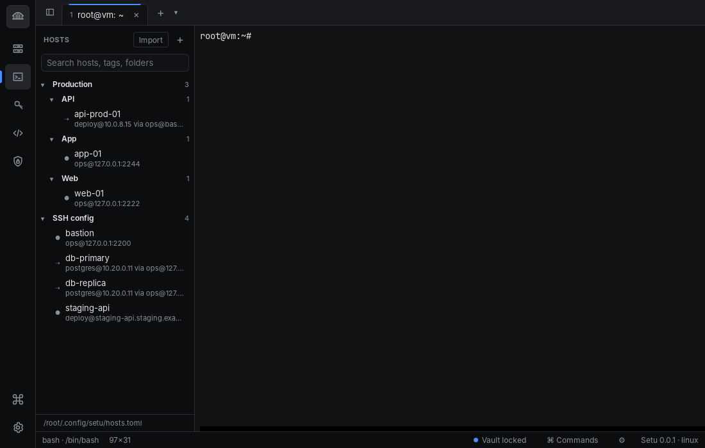

# Getting started

This page takes you from download to your first SSH session and file upload. It should take a few minutes.

> Setu is **pre-alpha**. The builds below are nightly snapshots: good for trying Setu, not yet for production machines.

## 1. Install Setu

Download the newest build for your system from the [`nightly` release](https://github.com/SanowerTamjit/setu/releases/tag/nightly):

| System | Download | Notes |
|---|---|---|
| Windows 10/11 (x64) | `.msi` or `-setup.exe` | Until the builds are code-signed, SmartScreen shows "Windows protected your PC": choose **More info → Run anyway**. |
| macOS 10.13+ (Apple silicon and Intel) | `.dmg` | Drag Setu to Applications. The first time, right-click it and choose **Open**, then **Open** again. On macOS 15 and later use **System Settings → Privacy & Security → Open Anyway**. |
| Linux x86_64 (Ubuntu 22.04, Debian 12, Fedora 36 or newer) | `.deb`, `.rpm` or `.AppImage` | For the AppImage, `chmod +x` the file, then run it. |

Every file is listed in `SHA256SUMS`, and each one has a build attestation that proves it came from this repository. [Checking a download](../developer/releasing.md#checking-a-download) shows how to verify them.

The same release has the `setu` command-line tool (`setu-cli-…` archives). See [The command line](cli.md).

You can also [build Setu from source](../developer/setup.md).

## 2. First launch

Setu opens straight into a terminal running your default shell. There is no account, no sign-in and no setup wizard, and nothing is sent anywhere.

Setu asks once what kind of work you do. **System administrator** turns on a pack of 25 ready-made commands (snippets); you can skip the question, and change it later in Settings → Packs. See [Snippets and packs](packs.md).

### A tour of the window

The default layout is called **Classic**:

- **The rail** on the far left: Hosts, Terminals, Workflows, SSH keys, Snippets and the Vault, then the layout switch, the command palette and Settings at the bottom.
- **The tab bar** across the top. **+** opens a new tab with your default shell; **▾** next to it lists every shell Setu found (bash, zsh, fish, PowerShell, cmd, WSL distros…), your shell profiles, **New SSH connection** and the split commands.
- **The terminal**, with the hosts sidebar beside it when you want it (Ctrl+Shift+H).
- **The status bar** at the bottom: the current session and its size, **Files** for SSH tabs, the vault state, **Commands** (the palette) and the Setu version.

Prefer a different look? **Studio** is a second layout with a title bar, a session navigator and a futuristic skin, and there are seven colour themes. See [Appearance](appearance.md).

The one shortcut worth remembering is **Ctrl+Shift+P** (Cmd+Shift+P on macOS): the command palette finds every command, host, shell, theme and snippet by typing a few letters.

## 3. Connect to a server

If you already use `ssh`, start by importing your hosts:

1. Click **Hosts** in the rail, then **Import**, and choose your `~/.ssh/config`. PuTTY, MobaXterm, CSV/Termius and Ansible inventories are there too.
2. Tick the hosts you want and click **Import N hosts**. Your SSH config is never changed.
3. Click **Connect** on a host card.

Or connect by hand: press **Ctrl+Shift+O** (New SSH connection), type the host, user and how to sign in, and click **Connect**.

The first time you reach a server, Setu shows its host key fingerprint and asks whether to trust it. Check it, then click **Trust and connect**. The key is saved in `~/.ssh/known_hosts`, shared with OpenSSH. [Connecting with SSH](ssh.md) explains what each choice means.

## 4. Copy a file

In an SSH tab, click **Files** in the status bar (or press **Ctrl+Shift+E**). A Files tab opens with your computer on the left and the server on the right, over the same connection. Drag a file from one side to the other, or select it and click **Upload →**. See [Files (SFTP)](files.md).

## 5. Save passwords (optional)

If a server asks for a password or a key passphrase, tick **Save in vault** and choose a master password. Next time, the host connects without asking. The vault is encrypted on disk and locks itself after 15 minutes. See [The vault](vault.md).

## Where next

- [Terminal tabs](terminal.md): splits, find, restoring tabs, hidden secrets.
- [Saved hosts](hosts.md): folders, tags, the jump-host map.
- [Workflows](workflows.md): run a command on many servers, with approvals.
- [Keyboard shortcuts](keyboard-shortcuts.md).
- Something not working? [Troubleshooting](troubleshooting.md).
