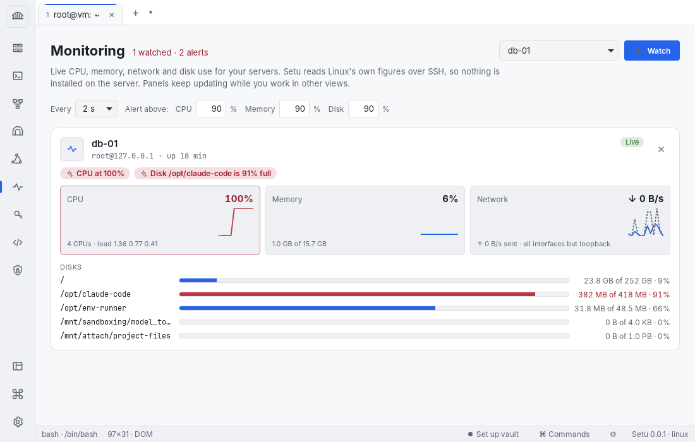
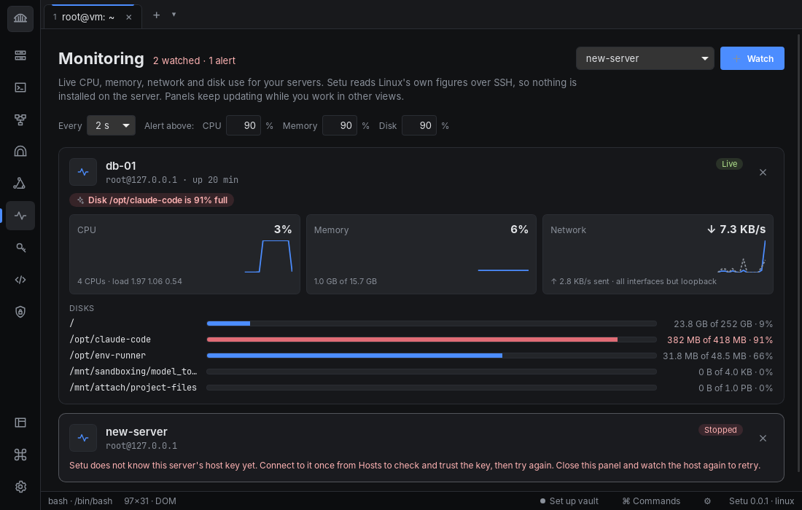

# Monitoring

See how busy your servers are, live: CPU, memory, network traffic and how full each disk is. Setu reads the figures Linux keeps in `/proc` and from `df` over SSH, so **nothing is installed on the server** and no port is opened.

Open the **Monitoring** view from the rail (Classic), the **Monitoring** switch in the title bar (Studio), or the command palette (`Go to monitoring`). It can be turned off in Settings → Features (`monitoring`).



## Watching a host

Pick a saved host at the top right and press **Watch**. A panel appears and fills in after a few seconds:

| Tile | Shows |
|---|---|
| **CPU** | How much of all CPUs was busy since the last reading, the number of CPUs and the load average (1, 5 and 15 minutes), with a two-minute history. |
| **Memory** | Memory in use (what Linux reports as not available) out of the total, and swap in use. |
| **Network** | Bytes a second received (↓, solid line) and sent (↑, dashed line) on every interface except loopback. |
| **Disks** | Each real file system (not `tmpfs`, `overlay` or snap loop devices): its mount point, a bar, and space used. |

The panel's subtitle shows how long the server has been up. Watch as many as eight hosts at once; panels keep updating while you work in other views, and close a panel (✕) to stop watching that host.

## Alerts

Under **Alert above**, set the limits for CPU, memory and disk (90% by default). When a reading reaches a limit, the panel shows a red alert, such as *CPU at 100%* or *Disk /var is 93% full*, and the view's title counts the alerts. Figures within 15 points of a limit turn amber. **Every** sets how often Setu reads the server: 2, 5, 10 or 30 seconds. Changes apply to every watched host straight away, and Setu remembers them on this computer.

## Logins and problems

Monitoring logs in the way [tunnels](tunnels.md) do, and never asks a question:

- The server's host key must already be trusted. Connect once from [Hosts](hosts.md) to check and trust it.
- A password or key passphrase comes from the [vault](vault.md), or use ssh-agent.

If the connection drops, the panel says **Reconnecting…** and tries again. After ten failures in a row, or a problem that will not fix itself (an unknown host key, a locked vault, a server that is not Linux), the panel stops and says why. Close it and press **Watch** again once the problem is fixed.



## What runs on the server

Each reading runs one fixed, read-only command, the same for every server:

```sh
export LC_ALL=C; for f in stat meminfo loadavg uptime net/dev; do echo "@@$f"; cat /proc/$f 2>/dev/null; done; echo @@df; df -P -k 2>/dev/null
```

It takes nothing from you or from the host's settings. Setu reads only numbers from what comes back (and disk mount points, cleaned of control characters), keeps nothing on disk, and logs nothing. It works on Linux servers; other systems (macOS, BSD, Windows) are not supported yet.
