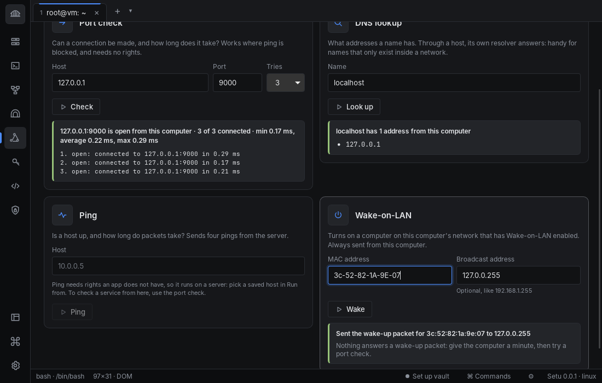
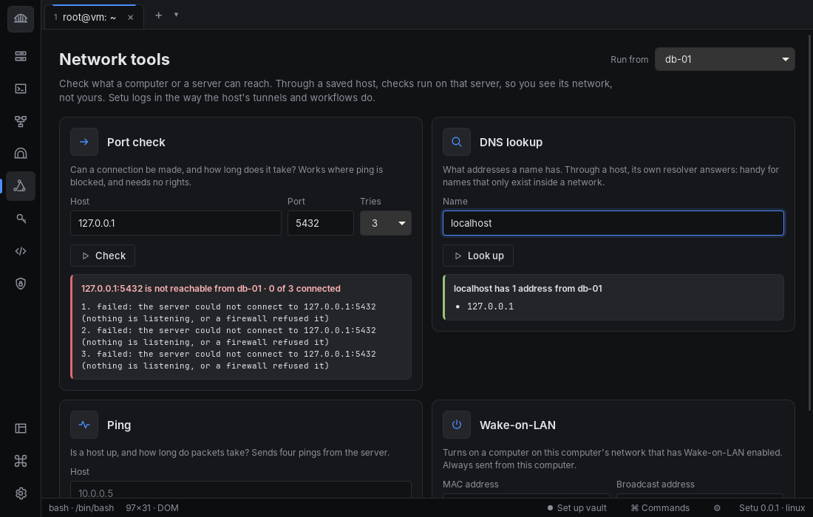
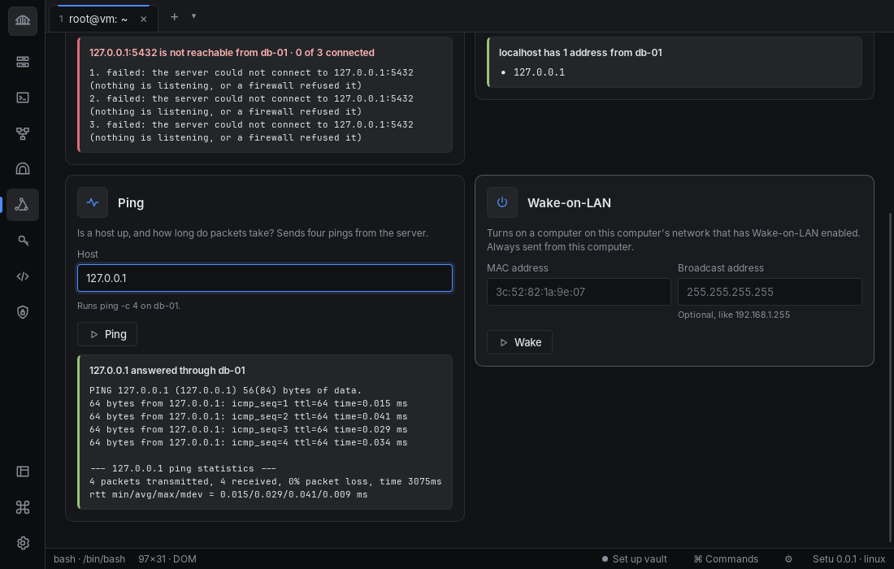

# Network tools

Quick checks for "can this reach that?": a **port check**, a **DNS lookup**, **ping** and **Wake-on-LAN**. Each check runs either from your computer or **through a saved host**, so you can see a server's network the way the server sees it, without opening a terminal and remembering the right command.

Open the **Network tools** view from the rail (Classic), the **Network** switch in the title bar (Studio), or the command palette (`Go to network tools`). It can be turned off in Settings → Features (`networkTools`).

## Run from

**Run from**, at the top right, picks where the port check, DNS lookup and ping run:

- **This computer**: the check is made by Setu itself, on your network.
- **A saved host**: Setu logs in to that server and the check runs there. Use it to ask "can the web server reach the database?" or "what does this name resolve to inside the network?".

Through a host, Setu logs in the way tunnels and workflows do: it never asks a question. The server's host key must already be trusted (connect once from [Hosts](hosts.md)), and a password or passphrase comes from the [vault](vault.md) or ssh-agent. Setu disconnects as soon as the check is done.

## Port check

Tries to open a TCP connection to a host and port, one to ten times, and says how long each one took. It is a "TCP ping": it works where ICMP ping is blocked and needs no special rights.

| Result | Means |
|---|---|
| **open**, with a time | Something is listening and accepted the connection. |
| **closed** (from this computer) | The host answered that nothing listens on that port. |
| **no answer in 5 seconds** | A firewall drops the connection, or the host is down. |
| **the server could not connect** (through a host) | The server tried and failed: nothing listens there, or a firewall refused it. SSH does not say which. |

Through a host, Setu asks the server to open the connection, as a tunnel would, and closes it at once; nothing is run on the server. The server must allow forwarding (`AllowTcpForwarding`, on by default in OpenSSH).

## DNS lookup

Lists the addresses a name resolves to (IPv4 first). From this computer it uses your system's resolver, so it sees `/etc/hosts` and your VPN's DNS. Through a host it runs `getent ahosts NAME` on the server, which uses the server's own resolver; this needs `getent`, which every Linux server has.

## Ping

Sends four ICMP pings and shows what `ping` printed. Ping needs rights that an app does not have, so it only runs **through a saved host** (`ping -c 4 -W 2 NAME` on the server). To check a service from your computer, use the port check instead.

## Wake-on-LAN

Sends a "magic packet" that turns on a computer whose network card has Wake-on-LAN enabled. Type its **MAC address** (`3c:52:82:1a:9e:07`, `3C-52-82-1A-9E-07` and `3c52.821a.9e07` all work). The packet is broadcast on your computer's network, so the computer must be on the same network (or a VPN that carries broadcasts). If your network is not the usual one, give its **broadcast address**, like `192.168.1.255`; Setu only sends to broadcast addresses.

Nothing answers a wake-up packet, so Setu can only say it was sent. Give the computer a minute, then try a port check on SSH (port 22) or RDP (3389).

## What Setu checks

Every host name you type must be a plain name or address (letters, digits, `.`, `-`, `_`, `:`), so it can never be read as a command or an option on the server. Setu checks this in the window and again before anything is sent. Checks are not saved anywhere.
