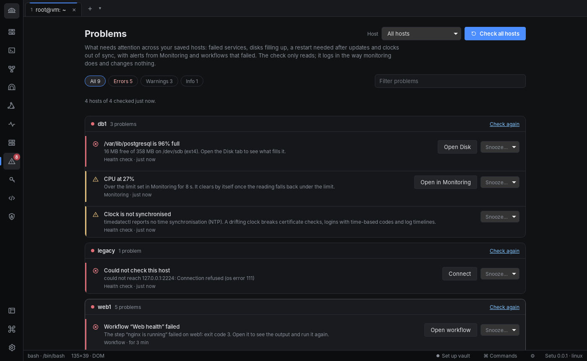

# Problems

One list of what needs attention across your saved hosts, like the problems list in a code editor: failed services, disks filling up, a restart needed after updates and clocks out of sync, together with alerts from [Monitoring](monitoring.md) and [workflows](workflows.md) that failed.

Open the **Problems** view from the rail (Classic), the **Problems** switch in the title bar (Studio), or the command palette (`Go to problems`). The number on its button counts errors and warnings. It can be turned off in Settings → Features (`problems`).

## Checking your hosts

Press **Check all hosts**. Setu logs in to each saved host, runs one read-only check and logs out again, six hosts at a time. Each host's problems appear as soon as it is done. To check one host, pick it under **Host** (the button becomes **Check *host***) or press **Check again** on its group.

The check never changes anything on the server. It looks at:

| Problem | Severity | Found when |
|---|---|---|
| **A unit failed** (`nginx.service failed`) | Error | systemd lists the unit as failed. Services open in the Server view, where you can read their logs and start them again. |
| **A disk is filling up** (`/var is 96% full`) | Warning at 90%, error at 95% | `df` shows the file system that full. It is counted the way `df` counts (space kept back for the system counts as used), so it can read a little higher than the Monitoring bar. **Open Disk** shows what fills it. |
| **Inodes are running out** | Warning at 90%, error at 95% | The file system is running out of file entries. New files then fail even with space free; it is usually many small files. |
| **Restart needed to finish updates** | Info | Debian or Ubuntu wrote `/var/run/reboot-required`. The packages that asked are listed. |
| **Clock is not synchronised** | Warning | `timedatectl` says time synchronisation (NTP) is not working. |
| **Could not check this host** | Error | Setu could not log in or the server did not answer. The reason is shown; **Connect** opens a terminal to the host, where you can trust its key or type a password. |

A check logs in the way monitoring and workflow runs do: with a password or passphrase saved in the [vault](vault.md) (unlock it first), or with your ssh-agent. It never asks for a password, and it never accepts a new or changed host key; connect to the host once from Hosts to trust its key. Checks need a Linux server; a part the server cannot answer (no systemd, no `timedatectl`) is skipped rather than reported.

Results are kept until Setu closes. The line under the filters says how many hosts have been checked and when.

## Monitoring and workflows

These appear without a check:

- **Monitoring alerts** that have lasted their hold time on hosts you are watching (`CPU at 97%`). They go away when the reading falls back under the limit or you stop watching. **Open in Monitoring** shows the host's panel.
- **Workflows whose latest run failed**, with the step and host that failed. A later run that succeeds clears it. **Open workflow** opens it in Workflows.

## Finding your way

- **All / Errors / Warnings / Info** show one severity.
- **Host** shows one host's problems.
- **Filter problems** matches words in the title, the details, the host name and where the problem came from (for example `monitoring`).

Problems are grouped by host, the hosts with errors first. Each one says where it came from and how long Setu has seen it.

## Snoozing

To hide a problem you already know about, pick **Snooze… → 1 hour, 1 day or 1 week**. Snoozed problems move to **Snoozed** at the bottom, which says when each comes back; **Show again** brings one back early. A workflow that fails again shows again, even if its last failure was snoozed.

Snoozes are saved in `problems.json` in Setu's config folder (see [Settings and your files](settings.md)), so they last after a restart. The file holds problem names (host, unit or mount point) and times, nothing else.
