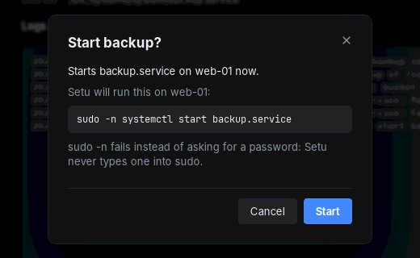
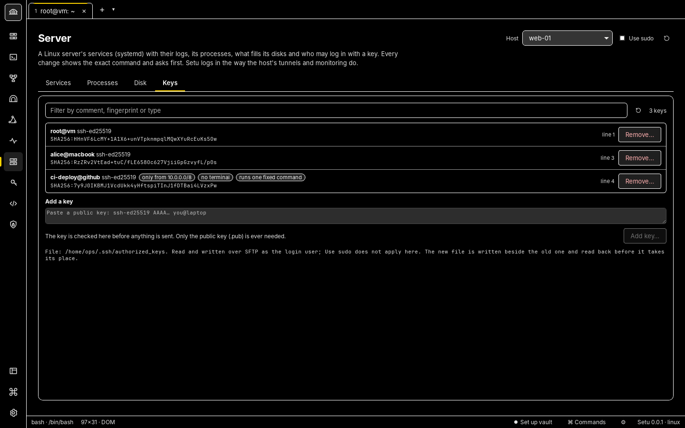

# Server management

See and manage a Linux server: its services (which are running, which have failed and why; start, stop or restart them), its processes, and what fills its disks. Setu uses the server's own tools (`systemctl`, `journalctl`, `ps`, `kill`, `df`, `du`) over SSH, so **nothing is installed on the server**. Every change shows you the exact command first and waits for your yes.

Open the **Server** view from the rail (Classic), the **Server** switch in the title bar (Studio), or the command palette (`Go to server management`). It can be turned off in Settings → Features (`serverManagement`).


Pick a saved host at the top right, then a tab: **Services**, **Processes** or **Disk**. Setu remembers the host and the tab.

## Services

 Setu lists every service systemd has loaded, and those that are installed but not loaded (for example, turned off at boot and never started).

| In the list | Means |
|---|---|
| Green dot, **Running** | The service is up. **Done (ran once)** is a job that ran and finished without trouble. |
| Red dot, **Failed** | It stopped with an error. Open it to see why in its logs. |
| Hollow dot, **Stopped** | Not running. |
| Amber dot, **Starting** / **Stopping** | systemd is in the middle of it. |
| **Masked** | Turned off completely by an administrator; nothing can start it. |

Type in **Filter services** to find one by name or description, and use **All**, **Running**, **Failed** and **Stopped** to narrow the list (each shows how many). Press ↻ to read the list again.

Click a service to see its status: its main process, since when it runs, memory, tasks, how often systemd restarted it, whether it starts at boot, and its unit file.

## Logs

Under the status are the service's newest journal lines. Choose how many (**Last 50** to **Last 5000**) and which (**All lines**, **Warnings and errors**, **Errors only**). The line under the logs shows the exact command Setu ran.

If the logs only show a hint about "messages from other users and the system", your login may not read the system journal. Turn on **Use sudo**, or ask for your user to be added to the `systemd-journal` (or `adm`) group.

## Changing a service

The buttons offer only what makes sense now:

| Button | Runs | Does |
|---|---|---|
| **Start** | `systemctl start` | Starts it now. |
| **Restart** | `systemctl restart` | Stops and starts it. Connections to it drop for a moment. |
| **Reload** | `systemctl reload` | Asks it to read its settings again without stopping (not every service can). |
| **Stop** | `systemctl stop` | Stops it until it is started again. |
| **Start at boot** | `systemctl enable` | It starts each time the server boots. It does not start it now. |
| **Not at boot** | `systemctl disable` | It no longer starts at boot. It keeps running now. |

Before anything runs, Setu shows what will happen and the **exact command**, and waits. Stopping or restarting the service you log in with (`ssh`, `sshd`) or the network or firewall warns you that you could lose access.



Afterwards you see whether it worked and what the command printed, and the status and logs are read again. When it fails, Setu says why in plain words where it can (for example, that it needs administrator rights).

### Use sudo

Most changes need administrator rights. Tick **Use sudo** and Setu puts `sudo -n` in front of the commands (reads too, so you can see the system journal). `-n` means sudo fails at once instead of asking for a password: **Setu never types a password into sudo.** It works where your user may run `systemctl` and `journalctl` with sudo without a password. A line like this in `sudoers` (edit it with `visudo`) allows just those two:

```
deploy ALL=(root) NOPASSWD: /usr/bin/systemctl, /usr/bin/journalctl
```

If sudo wants a password, Setu tells you so; run the command in a terminal instead.

## Processes

The **Processes** tab lists what runs on the server, busiest first (or **Most memory first**): process id, user, CPU, share of memory, memory in use, how long it has run, and the command's name. Type to filter by name, user or process id; ↻ reads the list again. Up to 500 processes are listed.

Only the command's **name** is read, never its arguments, which can hold passwords. CPU is averaged over each process's whole life, the way `ps` counts it; for live figures use [Monitoring](monitoring.md).

Pick a process to stop it:

| Button | Runs | Does |
|---|---|---|
| **Stop** | `kill -TERM <pid>` | Asks it to stop; it can finish and clean up first. Try this first. |
| **Kill** | `kill -KILL <pid>` | Stops it at once, with no clean-up. Use it when Stop did not work. |

As with services, Setu shows the exact command and asks first, and warns before stopping what keeps the server up or reachable (`sshd`, `systemd`, the network). The system itself (process 1) cannot be stopped from here. Your own processes need no sudo; other users' need **Use sudo** (and sudo allowed to run `kill` without a password).

## Disk

The **Disk** tab shows each disk (not memory-backed or snap file systems): where it is mounted, its type and device, a bar, and how much is used and free. The bar turns amber from 80% and red from 90%.

To find what fills a disk, press **What uses it**, or type a folder and press **Measure**. Setu lists the folders in it, biggest first, staying on that disk (like `du -x -d 1`). Click a folder to go into it; use the path above the list or ↑ to go back up. Measuring a big folder can take up to a minute; folders you may not read are left out, so turn on **Use sudo** to see everything (sudo must be allowed to run `timeout` and `du` without a password). It only reads: nothing is deleted.


## Keys

The **Keys** tab shows who may log in to the server with an SSH key, as the user Setu logs in as: the keys in that user's `~/.ssh/authorized_keys`. Each key shows its comment (often who it belongs to), its type, its fingerprint (the same `SHA256:…` that `ssh-keygen -l` prints, so you can compare it with the key on someone's computer), its line in the file, and any limits on it in plain words (*only from 10.0.0.0/8*, *no terminal*, *runs one fixed command*). Type to filter by comment, fingerprint or type.



**To add a key**, paste a public key (one line from a `.pub` file, like `ssh-ed25519 AAAA… sam@laptop`) under **Add a key**. Setu checks it on your computer first and shows its comment and fingerprint; it refuses anything that is not one well-formed public key, a key already in the file, and keys with options. If you paste a **private** key by mistake, Setu clears it at once and tells you: never paste a private key anywhere. Press **Add key…**, check the fingerprint in the confirmation, and agree.

**To remove a key**, press **Remove…** beside it. The confirmation names the key and its fingerprint and warns you; if it is the only key in the file it says so, because nobody could log in as that user with a key afterwards, and that may include you. Sessions already open stay open.

How Setu changes the file, so a change cannot lock you out halfway:

- It writes the new file next to the old one, reads it back to make sure it arrived whole, and only then swaps it in. A dropped connection leaves the old file as it was.
- Every other line (comments, blank lines, keys it cannot read) is kept exactly as written.
- If the file changed on the server after Setu read it, a removal is refused ("authorized_keys changed since it was read") and the list is read again, so the wrong line is never removed.
- The file keeps its permissions, without group or other write access (which would make sshd ignore it). If the user has no file yet, adding a key creates `~/.ssh` (0700) and the file (0600).

Keys are read and written over SFTP as the login user. **Use sudo** does not apply here: to manage another user's keys, log in as that user. Setu manages `~/.ssh/authorized_keys` only; a server that keeps keys elsewhere (`AuthorizedKeysFile` in `sshd_config`) is not covered.

## Good to know

- Logins work like tunnels and monitoring: the key, agent or saved password is used without asking, and the server's host key must already be trusted (connect once from **Hosts**). Setu keeps the connection for five minutes so moving between services is quick.
- A build of Setu for an organization may refuse some changes by policy, and may record each change (who, which command, where, when and whether it worked; never the output).
- Needs systemd. On a server without it, Setu says so.
