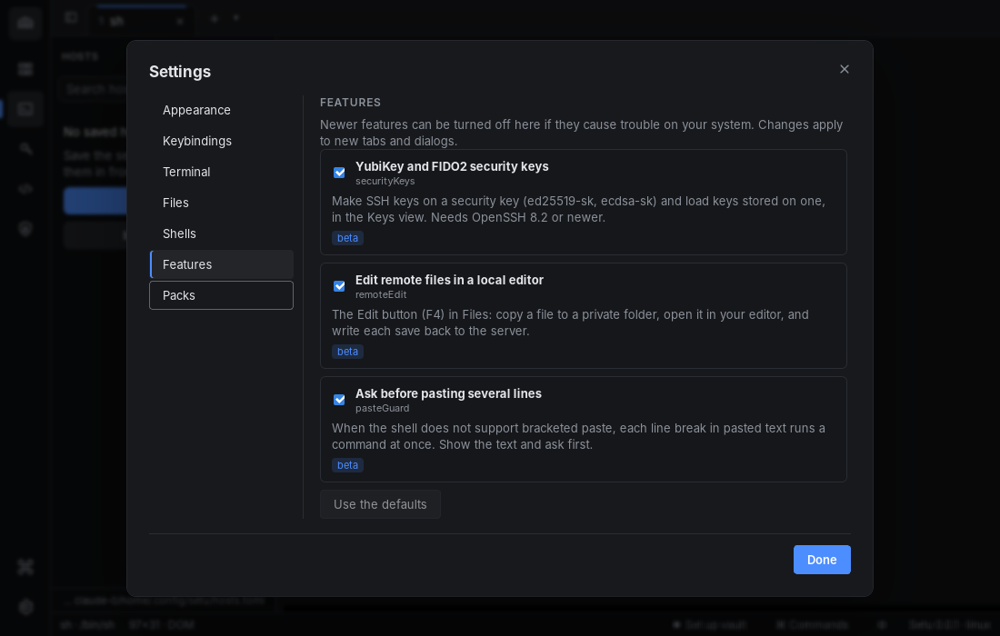

# Settings and your files

Open Settings with **Ctrl+,**, the gear at the bottom of the rail (Classic) or at the right of the title bar (Studio), or `Settings` in the command palette. Changes apply at once; there is no Save button.

## The pages

| Page | What you set there | More |
|---|---|---|
| **Appearance** | Theme, layout (Classic or Studio), terminal font size | [Appearance](appearance.md) |
| **Keybindings** | Default, Vim or Emacs profile | [Keyboard shortcuts](keyboard-shortcuts.md#vim-and-emacs-profiles) |
| **Terminal** | Renderer (Automatic, GPU, DOM), font, ligatures, hiding secrets in output | [Appearance](appearance.md#rendering-fonts-and-ligatures), [Terminal tabs](terminal.md#hiding-secrets) |
| **Files** | The editor that opens remote files (**Edit**, F4) | [Files](files.md#editing-a-remote-file-in-your-editor) |
| **Shells** | The shell new tabs start with, and your shell profiles | [Terminal tabs](terminal.md#shell-profiles) |
| **Features** | Turn newer features on or off (below) | |
| **Prompts** | Terminal colour schemes from other terminals; which prompt tools this computer uses | [Appearance](appearance.md#settings--prompts) |
| **Packs** | Your role, installed packs, install a pack from a file | [Snippets and packs](packs.md) |

## Features

Newer features ship behind switches, so if one misbehaves on your computer you can turn it off here without waiting for a new release. Each shows its stage: **beta** features are on unless you turn them off; **experimental** ones are off unless you turn them on.

| Feature | What turning it off does |
|---|---|
| YubiKey and FIDO2 security keys | Hides making and loading security keys in the Keys dialog |
| Edit remote files in a local editor | Hides **Edit** (F4) in Files |
| Ask before pasting several lines | Pastes go straight to the shell, without the check |
| Workflows | Hides the Workflows view and the task board |
| Tunnels | Hides the Tunnels view (tunnels already running keep going until you quit) |
| Network tools | Hides the Network tools view |
| Work memory and automation suggestions | Hides the Memory tab and stops all remembering |
| Prompt themes | No built-in Nerd Font symbols, Unicode 11 widths or imported colour schemes |

**Use the defaults** clears your choices. Security protections are never behind a switch.

## Where Setu keeps its files

Everything is a plain file in one folder, so you can back it up, copy it to another computer or keep parts of it in Git. Run `setu paths` to see the folder on your machine.

| System | Folder |
|---|---|
| Linux | `~/.config/setu` (or `$XDG_CONFIG_HOME/setu`) |
| macOS | `~/Library/Application Support/setu` |
| Windows | `%APPDATA%\setu` |

| File | What is in it | Secrets? |
|---|---|---|
| `settings.json` | Everything on the Settings pages | No |
| `hosts.toml` | Saved hosts ([format](hosts.md#format)) | No |
| `vault.json` | Saved passwords and passphrases, encrypted ([details](vault.md)) | Encrypted |
| `session.json` | The tabs to reopen after a restart: hosts, users, ports, key paths | No |
| `workflows/*.toml`, `workflow-runs.json` | Workflows and their run history ([format](workflows.md#files)) | No |
| `tunnels.toml` | Saved tunnels ([format](tunnels.md#files)) | No |
| `board.toml` | The task board ([format](workflows.md#task-board)) | No |
| `work-memory.json` | Commands remembered, if you turned work memory on ([details](work-memory.md)) | Masked |
| `packs/` | Packs you installed | No |

Setu also uses your `~/.ssh` folder (keys, `config`, `known_hosts`) exactly as OpenSSH does, and changes it only when you ask: making a key, trusting a host key, or forgetting one.

On macOS and Linux, files with personal data are readable only by you (mode 0600), and every file is written to a temporary file first and then renamed, so a crash never leaves half a file.

### Portable mode

Set the environment variable `SETU_HOME` to a folder, and Setu keeps everything in `$SETU_HOME/config` instead, for example on a USB stick or to try Setu without touching your real settings.

### Starting fresh

Quit Setu, then delete or rename the files you want to reset: `session.json` to start with one fresh tab, `settings.json` for default settings (and the role question again). Deleting `vault.json` deletes every saved password for good.
