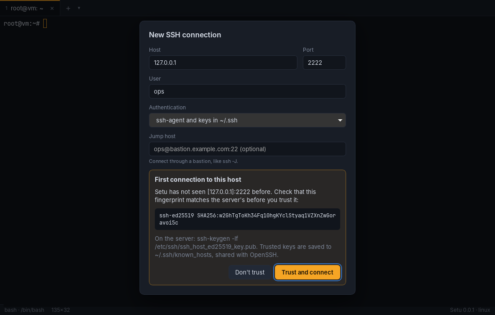
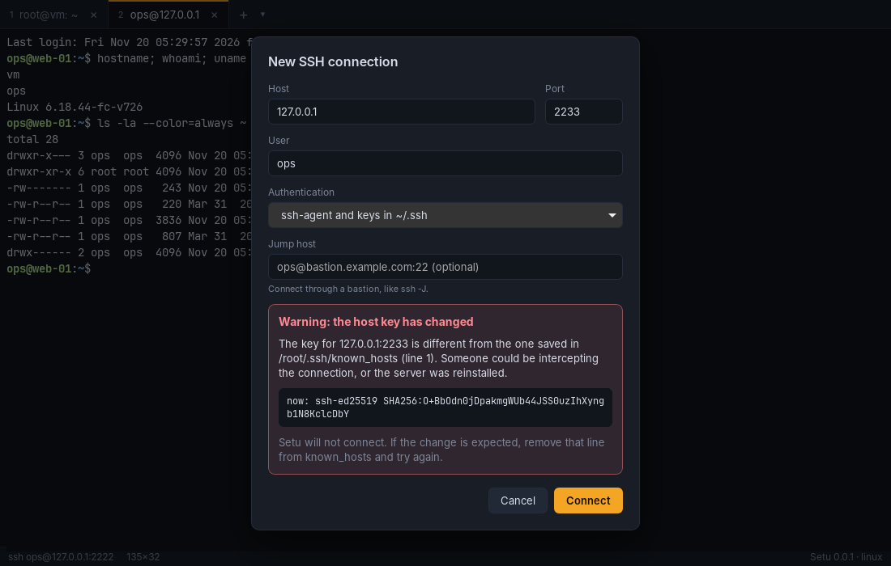
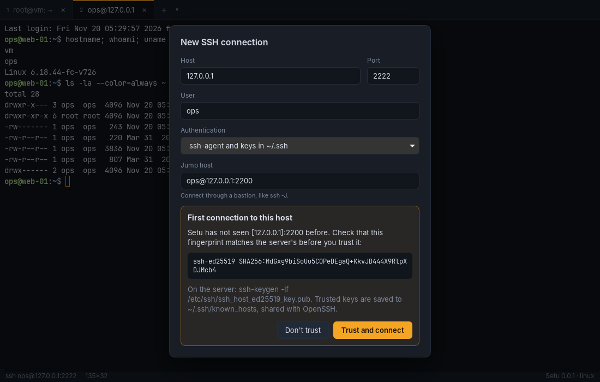

# Connecting with SSH

Setu has its own SSH client (built on [russh](https://github.com/Eugeny/russh)), so it does not need `ssh` installed. It reads the same files as OpenSSH: your keys in `~/.ssh`, `~/.ssh/known_hosts` and ssh-agent. Whatever works with `ssh` works in Setu, and the other way round.

## Opening a connection

- **A saved host:** click **Connect** on its card in the Hosts view, double-click it (or press Enter) in the hosts sidebar, or type its name in the command palette (`Connect: web-01`). See [Saved hosts](hosts.md).
- **Any host:** press **Ctrl+Shift+O**, or choose **New SSH connection…** in the **▾** menu next to the new-tab button.

The **New SSH connection** dialog asks for:

| Field | Meaning |
|---|---|
| Host, Port | The server's address or DNS name, and its port (22 by default) |
| User | The remote user. Empty means your local user name, as in OpenSSH |
| Authentication | How to sign in (below) |
| Jump host | Optional bastion to go through, like `ssh -J` (below) |

### Ways to sign in

| Choice | What Setu does |
|---|---|
| **ssh-agent and keys in ~/.ssh** (the default) | Tries the keys ssh-agent holds (Pageant or the OpenSSH agent service on Windows), then the default key files in `~/.ssh` (`id_ed25519`, `id_ecdsa`, `id_rsa`, and the security-key files `id_ed25519_sk` and `id_ecdsa_sk`), like OpenSSH |
| **ssh-agent only** | Only keys in the agent |
| **Key file** | One private key file; asks for its passphrase if it has one |
| **Password** | Asks for the password |

Passwords and passphrases can be kept in the encrypted [vault](vault.md): tick **Save in vault**. It is saved only after the login works, and next time the field can stay empty. YubiKeys and other FIDO2 keys are covered in [SSH keys and known hosts](ssh-keys.md#security-keys-yubikey-and-other-fido2-keys).

## Trusting a server: host keys

Every SSH server has a host key. Checking it is how you know you reached the real server and not someone in between. Setu checks strictly and never accepts a key on its own.

**First connection.** Setu shows the key's fingerprint and asks you to check it. Compare it with what the server's administrator gives you, or run `ssh-keygen -lf /etc/ssh/ssh_host_ed25519_key.pub` on the server. **Trust and connect** saves the key in `~/.ssh/known_hosts`; **Don't trust** stops.

**A changed key.** If a server presents a different key from the one saved, Setu **refuses to connect** and shows which `known_hosts` line holds the old key. This happens when a server is reinstalled, but it is also exactly what an attack looks like. If you know why the key changed, remove the old entry (**Forget** in [Known hosts](ssh-keys.md#known-hosts), or `ssh-keygen -R host`) and connect again to check the new one.

Some things are refused on purpose:

- Host names that could not be a real address (with spaces, commas, `*`, `?`, `!` and similar), so trusting one host can never trust a key for every host.
- SSH host certificates (`@cert-authority` lines) are not checked yet, so such hosts are refused rather than trusted.
- [Workflows](workflows.md) never show a trust prompt, because nobody may be watching. Connect to a host once from a terminal to trust it first.

## Jump hosts (bastions)

Type the bastion in **Jump host** as `user@host:port`, or several separated by commas (`ops@edge.example.com,ops@bastion:2200`) to hop through each in turn, as `ProxyJump` does. Each hop gets its own host-key check, so you may be asked to trust the bastion first.

Saved hosts keep their jump host (`jump` in `hosts.toml`), and hosts imported from `~/.ssh/config` bring their `ProxyJump`. `ProxyCommand` is never run. The [jump-host map](hosts.md#jump-host-map) draws which hosts sit behind which bastion.

## In the session

- **Split** an SSH pane (Ctrl+Shift+D) for another shell on the same server over the same connection: no new login.
- **Files** in the status bar (Ctrl+Shift+E) opens an SFTP browser on that server, also without a new login. See [Files (SFTP)](files.md).
- Setu asks the server for 24-bit colour (`COLORTERM=truecolor`). Many servers only accept `LANG` and `LC_*`; see [Appearance](appearance.md#prompt-themes-powerlevel10k-oh-my-zsh-starship-oh-my-posh) if prompts look washed out.
- After a restart, SSH tabs come back waiting for **Enter** to reconnect. See [Terminal tabs](terminal.md#tabs-come-back-after-a-restart).

## When a connection fails

The error says why in plain words: wrong password, a key the server did not accept, a key with a passphrase and no vault, no ssh-agent running, a host key that changed. Run `setu doctor` in a terminal for a check of your keys, agent and SSH config with a fix for each problem (see [The command line](cli.md)), and see [Troubleshooting](troubleshooting.md).
