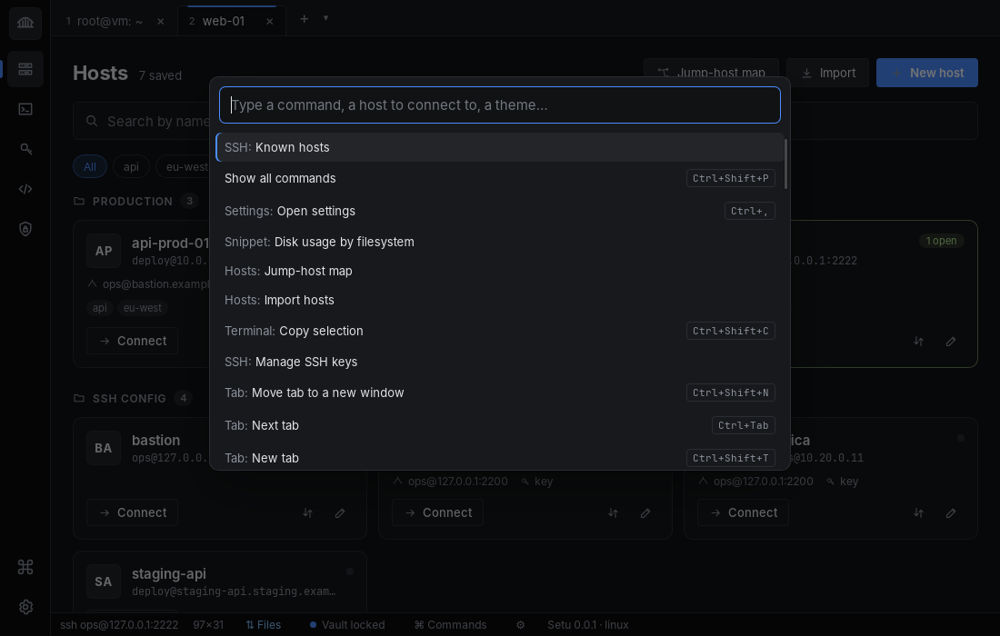
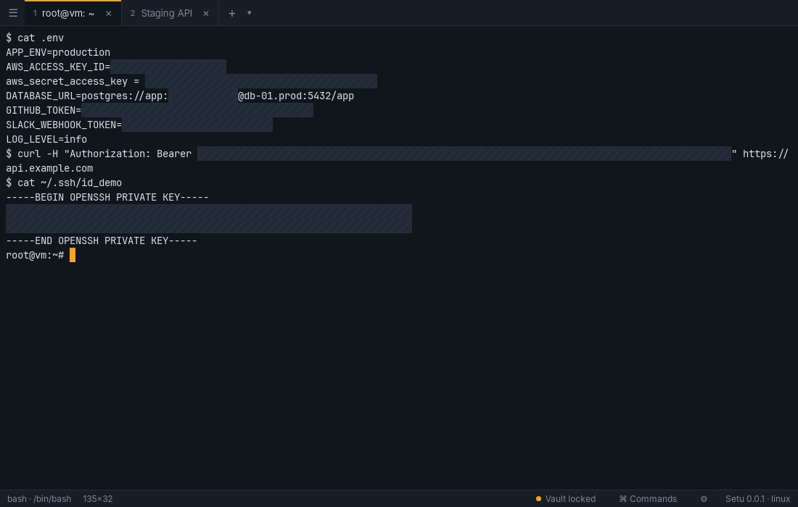
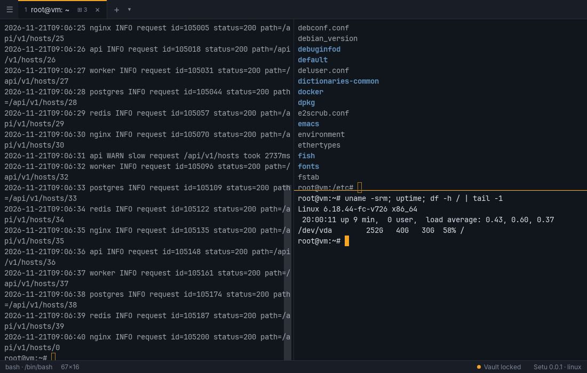
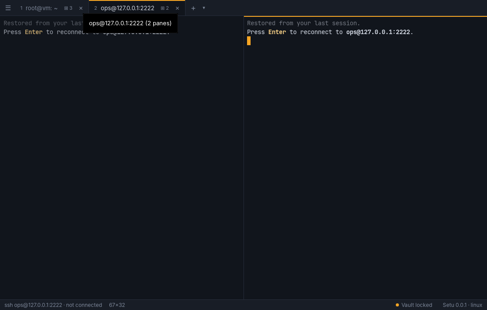
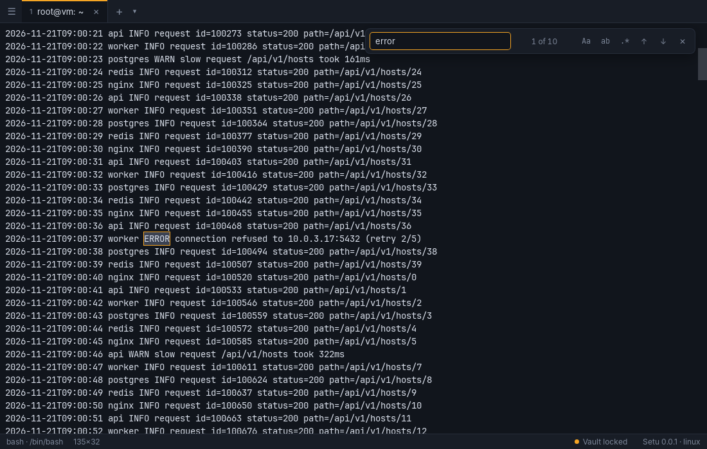

# Terminal tabs

Each tab is a local shell or an SSH session. Shortcuts use Ctrl+Shift (Cmd+Shift on macOS), so plain Ctrl keys still reach the shell. For themes, layouts, fonts and prompts, see [Appearance](appearance.md); for connecting to servers, see [Connecting with SSH](ssh.md).

## Keyboard shortcuts

These are the main ones; [Keyboard shortcuts](keyboard-shortcuts.md) lists every shortcut in one place.

| Shortcut | Action |
|----------|--------|
| Ctrl+Shift+T | New tab with your default shell |
| Ctrl+Shift+O | New SSH connection |
| Ctrl+Shift+W | Close the focused pane, or the tab when it has one pane |
| Ctrl+Shift+D | Split the focused pane side by side |
| Ctrl+Alt+Shift+D | Split the focused pane stacked (one above the other) |
| Alt+Arrow keys | Move focus to the pane in that direction |
| Ctrl+Tab, Ctrl+Shift+Tab | Next and previous tab |
| Ctrl+Shift+H | Show the hosts sidebar and search it |
| Ctrl+Shift+F | Find in the tab's scrollback |
| Ctrl+Shift+E | Open Files (SFTP) on the SSH tab's server |
| Ctrl+Shift+C, Ctrl+Shift+V | Copy the selection, paste |
| Ctrl+Shift+P | Command palette |
| Ctrl+Shift+N | Move the tab into a window of its own |
| Ctrl+, | Settings |

## Command palette

Ctrl+Shift+P opens one search box over everything: commands, saved hosts (`Connect: web-01`), shells and shell profiles (`New tab: …`), open tabs, themes, keybinding profiles and snippets from your packs. Type a few letters in any order of words; Enter runs the highlighted entry. With nothing typed, the commands you used last come first. Each entry shows its shortcut, if it has one.

## Keybinding profiles

Settings → Keybindings chooses a profile. Every profile keeps the Ctrl+Shift shortcuts above; Vim and Emacs add a prefix key followed by one key, the way tmux and Emacs work, so single keys still reach the shell. The status bar shows the prefix while Setu waits for the next key (two seconds). Press the prefix twice to send it to the shell.

| Action | Vim (Ctrl+Space, then) | Emacs |
|--------|------------------------|-------|
| Command palette | `:` | Alt+X |
| Split side by side / stacked | `v` / `s` | Ctrl+X `3` / Ctrl+X `2` |
| Close pane | `x` | Ctrl+X `0` |
| Move between panes | `h` `j` `k` `l` | Ctrl+X `o` |
| New tab / next / previous | `t` / `n` / `p` | Ctrl+X `t` / Ctrl+X Right / Ctrl+X Left |
| Find, Files | `/`, `f` | Ctrl+X `s`, Ctrl+X `d` |

## Tabs in their own window

Drag a tab out of the tab bar and let go outside the window, or press Ctrl+Shift+N, and the tab moves into a new window with its panes, scrollback and running shells or SSH sessions untouched: nothing restarts. Closing that window ends its shells. Only the main window's tabs come back after a restart.

## Shell profiles

Settings → Shells sets the shell new tabs start with, and holds your own profiles: a detected shell plus a starting folder, extra arguments and environment variables (one `NAME=value` per line). Profiles appear in the new-tab menu (▾) and the palette. For a WSL distro the folder is a Linux path and the variables are passed into Linux (through `WSLENV`). A missing folder or a bad variable name stops the tab with a message instead of starting somewhere else.

## Hiding secrets

Setu covers things that look like secrets in terminal output with a striped bar: cloud keys (AWS access and secret keys, Google API keys), tokens (GitHub, GitLab, Slack, Stripe, JWTs, `Bearer` tokens), passwords in URLs (`postgres://app:…@db`), `password=`/`token:`-style assignments, and the body of private key blocks. It works in the scrollback and in full-screen programs such as `less` and `vim`.

The text underneath is not changed: selecting and copying gives the real value. Hover a bar to see what kind of secret it hid; click it to show that one. Turn the feature off in Settings → Terminal or with the palette (`Hide secrets in output`). It is pattern matching, so treat it as a guard against shoulder-surfing and screen shares, not a guarantee.

## Split panes

A tab can hold several terminals. **Ctrl+Shift+D** splits the focused pane side by side, **Ctrl+Alt+Shift+D** splits it stacked; both are also in the **▾** menu next to the new-tab button. Splits nest, so you can build any grid.

- **What opens in the new pane:** for an SSH pane, another shell on the same server over the same connection, so there is no new login, password or passphrase prompt (jump hosts are shared too). For a local pane, a new shell of the same kind (bash, PowerShell, …).
- **Focus:** click a pane or use **Alt+Arrow keys**. The focused pane has a line in the theme's accent colour along its top; the others are slightly dimmed. The tab title, the status bar, **Files** and **Find** follow the focused pane.
- **Resize:** drag the line between two panes. Double-click it to share the space evenly again.
- **Close:** **Ctrl+Shift+W** closes the focused pane and its neighbour takes the space. A shell that exits (`exit`, Ctrl+D) closes its pane too, unless it is the last one in the tab, which stays to show the exit code. The **×** on the tab closes all of its panes.
- The tab shows **⊞ 2**, **⊞ 3**, … when it holds more than one pane.

Closing one SSH pane leaves the connection open for the others; it closes when the last pane or Files tab using it closes.

## Tabs come back after a restart

When Setu starts, it reopens the tabs you had open, with the same splits, divider positions, focused pane and active tab.

- **Local panes** start a fresh shell of the same kind. The scrollback and running programs are not kept, and neither is the working directory (yet).
- **SSH panes** don't connect by themselves. Each one shows "Press Enter to reconnect to user@host". Enter connects without showing the dialog, unless something is needed: a password or passphrase (or the vault to unlock), or a host key to trust. Panes of one tab that shared a connection share it again, so a split SSH tab needs one login.
- **Files tabs** are not reopened; open them again from the SSH tab (Ctrl+Shift+E).

The layout is saved as `session.json` in Setu's config folder (`setu paths` shows where) a moment after each change. It holds host names, ports, user names, the authentication method and key file paths, never passwords, passphrases, anything you typed or any output. On Unix only you can read it. To start with a single fresh tab, quit Setu and delete that file.

## Find in scrollback

Press **Ctrl+Shift+F** in a terminal tab (in a split tab, it searches the focused pane). If text is selected on one line, the search starts with it.

- Results update as you type. **Enter** goes to the next match, **Shift+Enter** to the previous one; the ↑ and ↓ buttons do the same.
- The counter shows which match is selected out of how many. Above 1,000 matches it shows "1000+" and only highlights the first 1,000.
- **Aa** matches case, **ab** matches whole words only, and **.\*** treats the text as a regular expression (JavaScript syntax). An unfinished pattern shows "Invalid pattern" instead of searching.
- **Escape** closes the bar, clears the highlights and returns to the shell.

The search covers the tab's scrollback, which keeps the last 10,000 lines.

