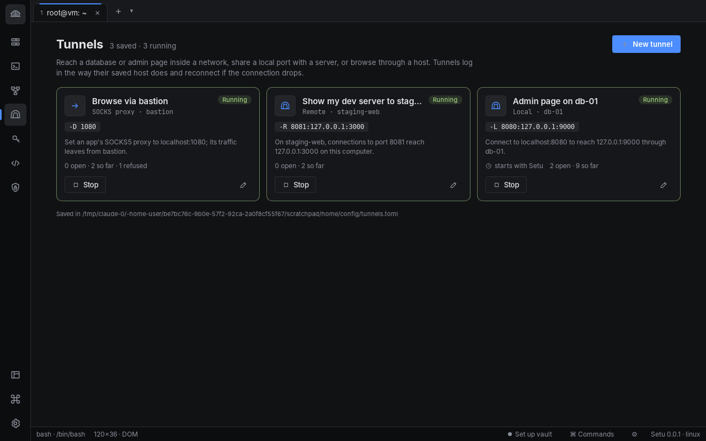
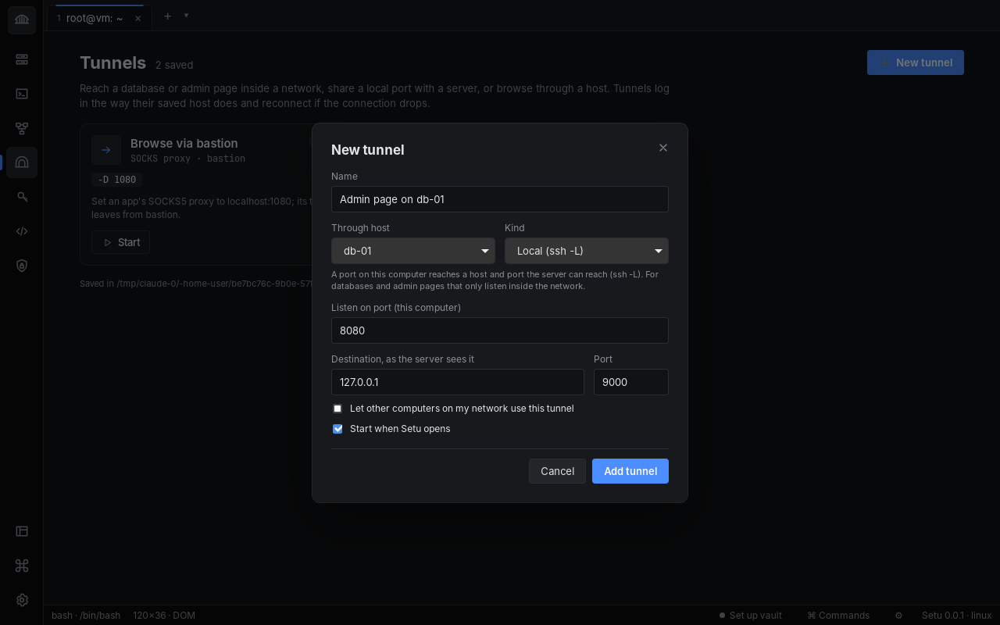
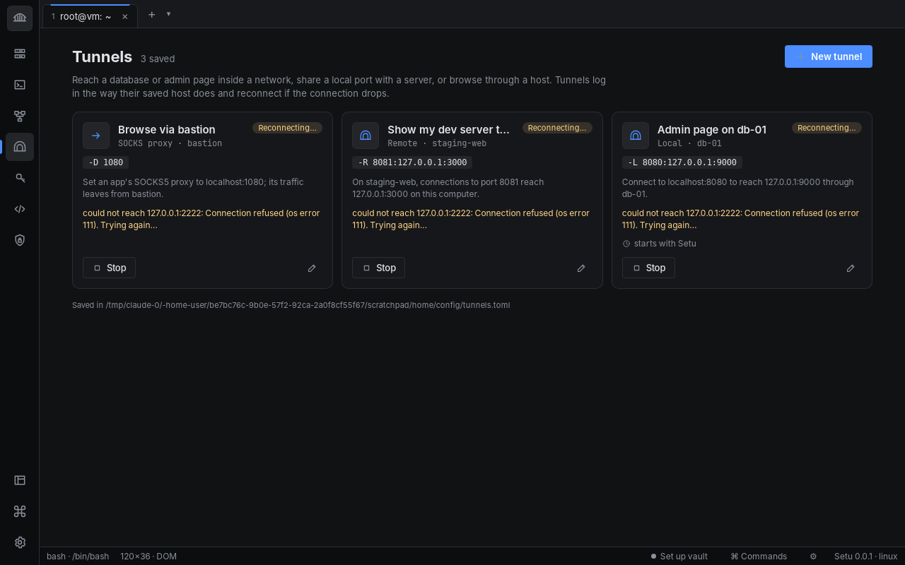

# Tunnels

A tunnel carries network connections through an SSH login, the way `ssh -L`, `ssh -R` and `ssh -D` do. Use one to open a database or admin page that only listens inside a server's network, to let a server reach a dev server on your laptop, or to browse as if you were in the server's network.

Open the **Tunnels** view from the rail (Classic), the **Tunnels** switch in the title bar (Studio), or the command palette (`Go to tunnels`). It can be turned off in Settings → Features (`tunnels`).



## Kinds of tunnel

| Kind | Like | What it does | Typical use |
|---|---|---|---|
| **Local** | `ssh -L 5433:127.0.0.1:5432 db-01` | Setu listens on a port on your computer. Each connection to it goes through the server to a destination *the server* can reach. | Connect your database client to `localhost:5433` to reach Postgres that listens only on `db-01` itself. |
| **SOCKS proxy** | `ssh -D 1080 bastion` | Setu runs a SOCKS5 proxy on your computer. Apps that use it say where they want to go, and the server makes the connection. | Set your browser's SOCKS proxy to `localhost:1080` to open internal web pages through a bastion. |
| **Remote** | `ssh -R 8081:127.0.0.1:3000 staging` | The *server* listens on a port. Each connection to it comes back to a destination *your computer* can reach. | Let a colleague on the server open your local dev server on `staging:8081`. |

Each card shows the tunnel as an OpenSSH option (`-L 5433:127.0.0.1:5432`) and one line on how to use it.

## Making a tunnel

Press **New tunnel**, then fill in:

- **Name**: what you will see on the card.
- **Through host**: the saved host whose login carries the tunnel. Add the server in [Hosts](hosts.md) first.
- **Kind**: Local, SOCKS proxy or Remote.
- **Listen on port**: the port on your computer (Local, SOCKS) or on the server (Remote). Ports below 1024 usually need administrator rights, so pick a higher one.
- **Destination** and **Port** (Local and Remote): where connections go. For a Local tunnel, `127.0.0.1` means *the server itself*; for a Remote tunnel it means *your computer*.
- **Start when Setu opens**: start this tunnel every time Setu starts.



Press **Start** on a card to open the tunnel and **Stop** to close it (and every connection it carries). While it runs, the card counts the connections open now, the ones carried so far, and any the far end refused. Edits to a running tunnel apply the next time it starts.

## Who can use a tunnel

By default a tunnel listens only on `127.0.0.1`, so only programs on your computer can use it (for a Remote tunnel, only programs on the server).

**Let other computers on my network use this tunnel** makes it listen on every address instead. Anyone who can reach that port then uses your SSH login: for a SOCKS proxy that means browsing through your server with no password. The dialog warns about this, and the card says *open to the network*. Leave it off unless you trust the network. For Remote tunnels the server decides too: OpenSSH only listens on other addresses when its `GatewayPorts` setting allows it.

## Logins, reconnecting and errors

Tunnels never ask questions, so they can start on their own:

- The server's host key must already be trusted. Connect to the host once from [Hosts](hosts.md) to check and trust it. A new or **changed** host key stops the tunnel with a message; it never connects past one.
- A password or key passphrase comes from the [vault](vault.md) (save it once when you connect), or use ssh-agent. If the vault is locked, unlock it and press **Start** again.

If the connection drops while a tunnel runs (Wi-Fi changes, the server restarts), the card says **Reconnecting…** and Setu tries again after 2, 4, 8, 16 and then every 30 seconds, for about a quarter of an hour. Once it is back the card shows how many times it reconnected. A tunnel that fails to start the first time, or whose port is already in use, stops with the reason and does not keep retrying.



Tunnels stop when you quit Setu.

## Files

Tunnels are kept in `tunnels.toml` in Setu's config folder (see [Settings and your files](settings.md#where-setu-keeps-its-files)). It is plain TOML, readable only by you, and holds no passwords:

```toml
version = 1

[[tunnel]]
id = "postgres-on-db-01"
name = "Postgres on db-01"
host = "db-01"            # a saved host's name
kind = "local"            # local, remote or dynamic (SOCKS)
bind_port = 5433
target_host = "127.0.0.1"
target_port = 5432
auto_start = true
# bind_address = "0.0.0.0" # only if other computers may use it
```

A tunnel names its host, so renaming or deleting that host breaks the tunnel; its card says so when you press **Start**. Setu checks the file when it loads it, and will not write over a file it could not read.
