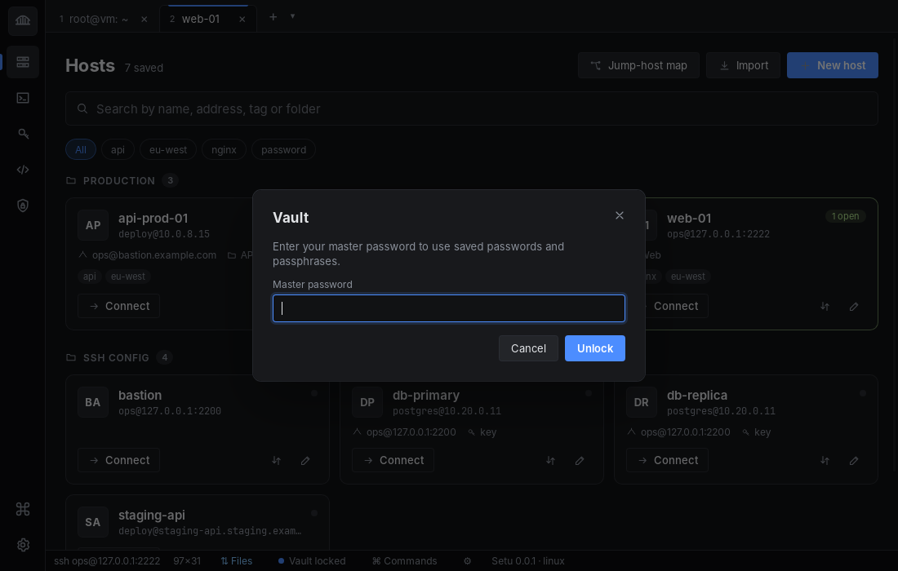
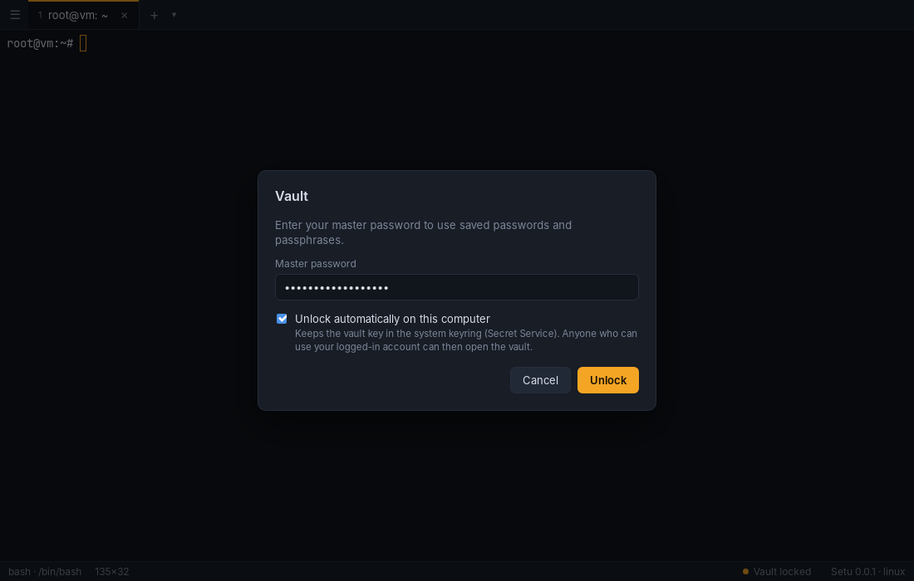

# The vault

Setu can remember SSH passwords and private-key passphrases in an encrypted vault, so saved hosts connect without asking. The vault is optional: without it, Setu asks for passwords and passphrases at every connection, and saved hosts (`hosts.toml`) never contain secrets.

## Using it

- **Set up:** click **Set up vault** in the status bar, or tick **Save in vault** while connecting. You choose a master password of at least 8 characters.
- **Save a secret:** tick **Save in vault** under the password or passphrase field. It is saved only after the connection works.
- **Use it:** when the password or passphrase field is left empty, Setu uses the saved one. If the vault is locked, the connect dialog offers to unlock it.
- **Lock:** the vault locks itself after 15 minutes without use, and **Lock now** locks it at once. Quitting Setu locks it too.
- **Remove a secret, or change the master password:** open the vault from the status bar.
- **Unlock automatically:** tick **Unlock automatically on this computer** when you unlock, or turn it on in the vault dialog. See below.



There is no recovery. If you forget the master password, the saved secrets are gone; nobody can reset it.

## Unlocking automatically

With **Unlock automatically on this computer** on, Setu keeps the vault's derived key (never the master password) in your operating system's credential store, and opens the vault from it at start-up and whenever it is needed:

| System | Store |
|--------|-------|
| macOS | Keychain |
| Windows | Credential Manager |
| Linux | Secret Service (GNOME Keyring, KWallet or KeePassXC), over D-Bus |



The entry is named `dev.setu.vault`, with the vault file's path as the account.

- The idle timeout still clears the key from Setu's memory; the vault reopens from the store on next use, so you are not asked again.
- **Lock now** locks until you type the master password, even with this on.
- Turning it off deletes the stored key.
- Changing the master password updates the stored key. If the vault file changes elsewhere (another machine, a restored backup), the stored key no longer opens it: Setu deletes it and asks for the password once.
- If no store is available (for example Linux without a Secret Service running), the option is not offered, the vault dialog says why, and everything else works as before.

The trade-off: anyone or anything that can use your logged-in account can then open the vault without the master password, the same as for passwords your browser or OS remembers. Leave it off on shared or less trusted machines.

## How it is protected

| Part | Choice |
|------|--------|
| Key derivation | Argon2id, 64 MiB memory, 3 passes, 1 lane, 16-byte random salt, 32-byte key |
| Encryption | XChaCha20-Poly1305 (authenticated), new random 24-byte nonce on every save |
| Header integrity | Format, version, KDF settings, salt and cipher are the AEAD's associated data: changing any of them makes unlocking fail |
| File | `vault.json` next to `hosts.toml`, written atomically, mode `0600` on Unix |
| Memory | The derived key and secrets are zeroized when the vault locks; the master password is not kept |
| UI boundary | Stored secrets never go to the web view: the UI only sends secrets in (to connect or save) and gets back the list of saved targets |

A wrong master password and a damaged or altered file give the same error, on purpose.

What the vault does **not** protect against: malware running as your user while the vault is unlocked, a keylogger capturing the master password, or a weak master password (Argon2id slows guessing, it does not make a short password strong).

## File format

```json
{
  "format": "setu-vault",
  "version": 1,
  "kdf": { "algorithm": "argon2id", "memory_kib": 65536, "iterations": 3, "parallelism": 1 },
  "salt": "<base64>",
  "cipher": "xchacha20poly1305",
  "nonce": "<base64>",
  "ciphertext": "<base64>"
}
```

The decrypted contents are a JSON list of entries: kind (`sshPassword` for `user@host:port`, or `keyPassphrase` for a key file path), target, secret, and the time it was saved.

Changing the master password re-encrypts everything with a new salt and never lowers the KDF settings.
