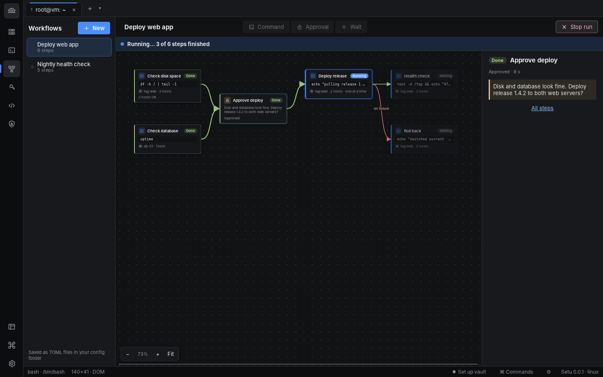
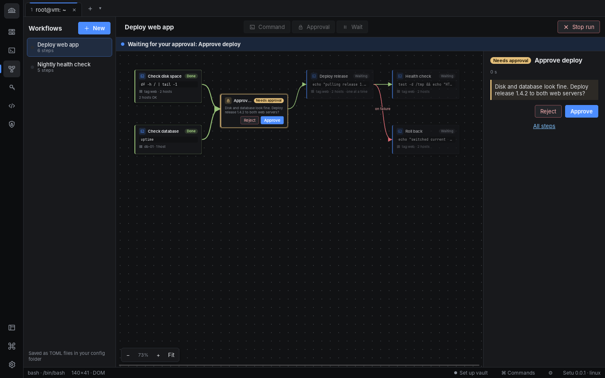
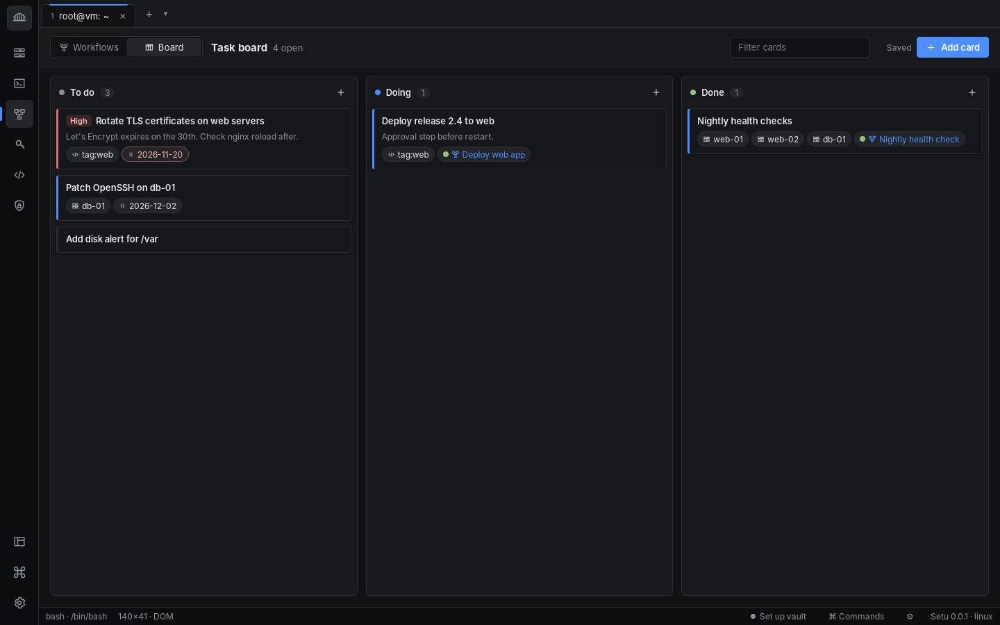

# Workflows

The **Workflows** view lets you draw the steps you would otherwise type into several terminals: run commands on your saved hosts, in order or at the same time, stop for an approval before a risky step, and roll back when something fails. Each run is kept in history with what every host printed.

Open it from the rail (Classic), the **Workflows** switch in the title bar (Studio), or the command palette (`Go to workflows`, `New workflow`). It can be turned off in Settings → Features (`workflows`).



## Steps

| Step | What it does |
|---|---|
| **Command** | Runs a command on one or more hosts, like `ssh host 'command'` (through the login shell, no terminal). Exit code 0 is success. With several hosts it runs on all of them at once, or **one host at a time**, stopping at the first failure (for rolling restarts). An optional **timeout** fails the host when it takes too long. |
| **Approval** | Pauses the run until you press **Approve** or **Reject** (on the step or in the side panel). Rejecting fails the step, so a failure link can roll back. |
| **Wait** | Pauses for a number of seconds, for example to let a service settle. |

Hosts are your saved hosts, by name, or `tag:<tag>` for every host with that tag (`tag:web`). The step shows how many hosts it will reach, and a name that is not a saved host is marked.

## Links

Drag the dot on a step's right edge onto another step to link them. Click a link to choose when it lets the next step run:

- **on success** (green): the previous step succeeded on every host. This is the default.
- **on failure** (red): the previous step failed, for alerts and rollbacks.
- **always** (grey, dashed): either way, for clean-up and summaries.

Steps that are not linked to each other run at the same time. A step with several incoming links waits for all of them and runs when every one of them fires; links from a step that was skipped are ignored, so branches can join again after an if/else. Links can never make a loop.

A run **fails** when a step fails and nothing handles it (no failure or always link out of it). A failure that a link handles, such as a health check that triggers an alert, does not fail the run.

## Running

**Run** saves the workflow and shows every command and the hosts it will run on before anything starts. While it runs, each step shows its state (waiting, running, needs approval, done, failed, skipped, stopped) and the links that fired are highlighted. Click a step to see each host's exit code and output. **Stop run** cancels steps that are running and everything still waiting.



Runs never ask for anything, because nobody may be watching:

- The host key must already be trusted: connect to the host once from Hosts to check and trust it. A changed key stops the step with a warning.
- Passwords and key passphrases come from the vault (unlock it first), or use ssh-agent. Keys and jump hosts set on the saved host are used as usual.
- Each host gets one connection for the whole run, closed when the run ends.

## From work memory

Setu can also suggest workflows for you: turn on **Work memory** in the **Memory** tab and it notices commands you run in the same order again and again, or one command you run on host after host, and offers each as a workflow draft. See [Work memory](work-memory.md).

## Task board

The **Board** tab next to **Workflows** (or **Open the task board** in the command palette) is a simple board for ops work: cards in **To do**, **Doing** and **Done**.

- **Add card** (or **+** on a column) opens the card editor: title, notes, column, priority, due date, the hosts or `tag:`s it is about, and the workflow that does the job.
- Drag a card to another column or place, or focus it and use **Alt+←/→** to move it between columns and **Alt+↑/↓** to reorder. **Enter** or a click opens it.
- A card with a workflow shows that workflow's last run (green succeeded, red failed); click the chip to open the workflow in the builder.
- High-priority cards have a red edge, and a due date in the past turns red until the card is done.
- **Filter cards** matches titles, notes, hosts and workflow names.



The board saves as you go to `board.toml` in Setu's config folder, readable only by you. Cards never run anything on their own: a linked workflow runs only when you open it and press **Run**. If the file can't be read (for example after a hand edit with a mistake), the board says so and doesn't write over it.

```toml
version = 1

[[card]]
id = "c1"
title = "Rotate TLS certificates on web servers"
column = "todo"            # todo | doing | done
notes = "Expires on the 30th."
hosts = ["tag:web"]
workflow = "deploy-web"    # optional
priority = "high"          # low | normal | high
due = "2026-11-30"         # optional, YYYY-MM-DD
```

Limits: 500 cards, 200-character titles, 4000-character notes, 50 hosts per card.

## Files

Each workflow is a TOML file in `workflows/` in Setu's config folder (`~/.config/setu/workflows` on Linux), so you can keep it in Git or share it. Runs are kept in `workflow-runs.json` next to it (the last 100 runs, the last 8 KiB of output per host). Both are readable only by you. **Clear run history** in the list removes them.

```toml
version = 1
id = "deploy-web"
name = "Deploy web app"

[[step]]
id = "check"
name = "Check disk space"
kind = "command"          # command | approval | wait
command = "df -h / | tail -1"
targets = ["tag:web"]
x = 60                     # position on the canvas
y = 60

[[step]]
id = "approve"
name = "Approve deploy"
kind = "approval"
message = "Deploy release 1.4.2?"
x = 340
y = 60

[[step]]
id = "deploy"
name = "Deploy"
kind = "command"
command = "./deploy.sh 1.4.2"
targets = ["web-01", "web-02"]
one_at_a_time = true
timeout_seconds = 120
x = 620
y = 60

[[step]]
id = "rollback"
name = "Roll back"
kind = "command"
command = "./deploy.sh 1.4.1"
targets = ["tag:web"]
x = 900
y = 200

[[link]]
from = "check"
to = "approve"

[[link]]
from = "approve"
to = "deploy"

[[link]]
from = "deploy"
to = "rollback"
when = "failure"           # success (default) | failure | always
```

A file that does not parse, or breaks a rule (unknown step in a link, a loop, a command over 8 KiB, more than 100 steps or 200 hosts per step), is listed under the workflows with the reason and is never run.

## Security

- A workflow runs only the commands you see in it, on hosts from your inventory, as the user you log in with. Setu runs nothing locally.
- The app reads the workflow back from disk and checks it again before running; the window cannot send it commands of its own.
- Server output is shown as plain text: terminal escape sequences and control characters are removed.
- A workflow from someone else is a script: read every command before you run it, as you would a shell script.
